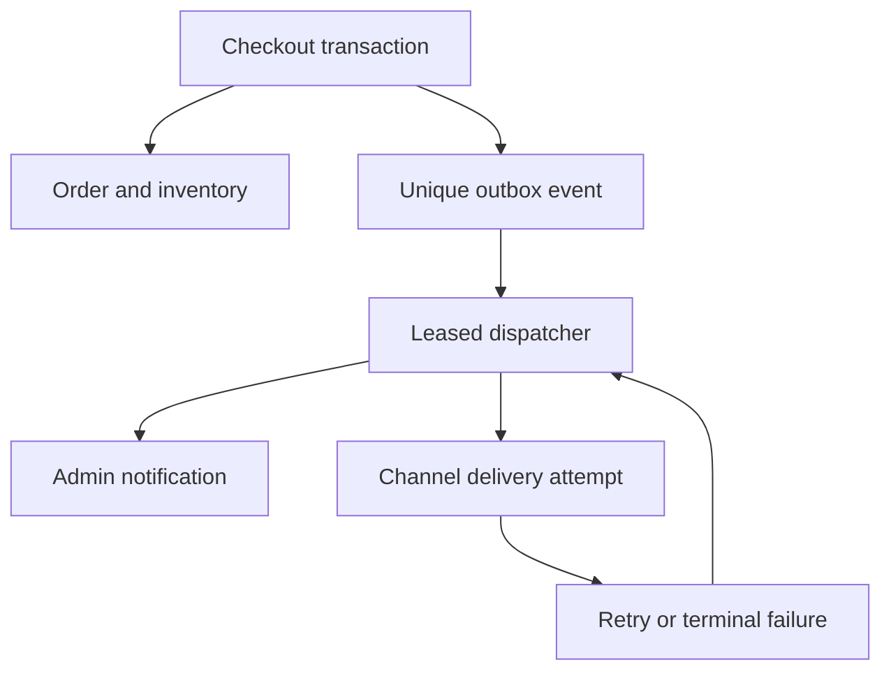

# ISHTAR 2.0 — Architecture and data decisions

23 October 2026. Everything labeled proposed is design only; no schema/migration/runtime change was applied in this audit.

## Current system

Next.js App Router/React/Prisma/PostgreSQL, server-side published catalog queries, client cart and product selection, authenticated server actions for admin, Cloudinary media, and synchronous post-commit Telegram sending. COD/order totals/delivery confirmation remain existing business logic.

`Order.checkoutRequestKey` is unique; request fingerprint detects changed-payload reuse. Order transaction takes a request-key advisory lock, validates current variants, conditionally decrements stock, writes snapshots/history/inventory and updates counters. Notifications occur after transaction completion. Preserve these safeguards. Conventional concurrent behavior is still unverified.

Current relevant relations: Category→Product→ProductVariant/ProductImage; Customer→Order→OrderItem/OrderStatusHistory/InventoryLog. HeroSettings stores validated JSON per home configuration. ProductVariant has no ProductImage relation. BackInStockRequest and AbandonedCart are not full application features. No outbox/read-receipt/push/staff audit models exist.

## Proposed durable event path

1. Enqueue event within the same order/stock transaction, only on newly committed order. Unique event key such as `order.created:<orderId>` prevents replayed checkout enqueuing again. External calls never occur inside that transaction.
2. Proposed tables: OutboxEvent (type, aggregate ID, minimal versioned payload, unique key, timestamps); OutboxDelivery (channel/destination reference, status, attempt count, nextAttemptAt, leaseUntil, safe error code, provider reference, unique event/channel/destination); optional attempt history with retention. Avoid duplicating full customer details in payloads; derive authorized contents when dispatching.
3. Claim bounded batches with transaction-safe leases/`SKIP LOCKED` where applicable; commit claim before sending. Recover expired leases. Retry retryable network/429/5xx failures using capped backoff/jitter, honor retry hints; surface terminal auth/config failures and manual retry to authorized staff.
4. Persist AdminNotification with event/entity reference and recipient/read state (either recipient join table or unique per-admin/event record). Delivery success and unread/read state are different concepts.
5. Telegram send is at-least-once under ambiguous network outcomes: Bot API sendMessage offers no application-supplied idempotency key. A crash after provider acceptance but before local success persistence can duplicate a message. Do not promise exactly-once delivery. Include stable order/event identifiers, suppress known duplicate work, surface uncertain attempts and define a retry policy. Customer channels with provider idempotency should use it.
6. Schedule dispatcher separately from checkout; evaluate the actual Netlify runtime/account before choosing scheduled/background execution. Keep a documented failed-worker path and pending count visible. No new paid provider is assumed.

## Admin freshness and permissions

Start with compact authenticated polling (target every 10s while visible; 5–15s acceptance under normal conditions), bounded cursor/counter payloads, no-store, abort previous request, no overlapping polls, exponential backoff, visibility/offline suspension and refresh on return. Detail fetch stays on demand. Avoid polling every full order/PII record. At 10s one visible tab makes about six feed requests/minute before backoff; measure actual function/DB cost. Hosted pub/sub may reduce requests at scale but requires provider/account review; persistent SSE/WebSockets are not presumed available from an ephemeral function.

Define capabilities for product/catalog, inventory, order view/edit/export/print, notifications and staff settings. Current `requireAdmin` must be extended rather than trusting client menu hiding or cookie role alone; DB-resolved active role is authoritative. `CATALOG_MANAGER` currently passes general admin guards, so restrict order PII/actions server-side after checking intended staff policy. Test every route handler/server action. Add login abuse protection after determining a suitable durable limiter; none was identified in the current login path. Preserve secure/httpOnly/sameSite cookies and fail-closed production signing secret.

## Additive data proposals by feature

| Feature | Smallest initial persistence change | Compatibility / caution |
| --- | --- | --- |
| F03/F05 | No DB table; bounded brand-scoped browser IDs | Server revalidates active IDs; handle storage exceptions |
| F04 | Optional `ProductVariant.imageId` relation to product media | Null preserves neutral gallery; validate referenced image belongs to same product; deletion clears link |
| F06 | Directed curated product associations, ordered and unique | No fake “frequently bought” metric; query current purchasable variants |
| F07/F14 | Look/LookItem or collection relations only after testing whether existing banner/tag model suffices | Optional media/text, explicit item order; no automatic discount |
| F22/F24 | Outbox + delivery + notification/recipient records | Add tables/indexes before enabling writer/dispatcher; feature flag; no data deletion on rollback |
| F25 | Threshold event state/version or equivalent locked transition state | Re-arm after restock; handle every stock mutation incl. cancel/manual changes; dedup under contention |
| F23 | Admin-device push subscription and lifecycle | Restricted endpoint access; server VAPID keys; no subscription/customer data in logs |
| F28 | Redacted actor audit events | Retention/access controls; no tokens/passwords or entire customer profiles |
| F09/F37 | Purpose/channel consent and revocation/expiry | Existing phone request model alone cannot establish permission |

## Migration and rollback protocol

The repository lacks a conventional migrations baseline; do not invent/reset history on an existing DB. Review additive SQL against a disposable conventional PostgreSQL clone, test reapplication/backward compatibility and indexes, document Prisma-client generation. Current Netlify build automatically executes hero-settings SQL: prepare separation from routine build and verify target mapping before any future schema deployment. A production build success does not confirm the intended DB was targeted.

Keep current preview database and Telegram configuration as the owner requested. Use an unrelated disposable synthetic DB for tests; do not silently repoint preview or create production infrastructure. New launch DB/channel/origin will be a distinct, explicitly approved release process.

Deploy compatibility sequence for future approved releases: additive schema first → app behind flags → worker enabled after verification. Roll back app/flags and stop new dispatch scheduling; retain pending events/tables and reconcile before restart. Removing a column/table or sending pending messages is not an automatic rollback step. No destructive SQL provided here.

## Privacy and operational fallbacks

Admin push text stays generic; deep links require fresh auth. Service worker must not cache authenticated orders/customer responses by default. Permission prompts follow explicit user interaction; failed/denied push leaves in-app/Telegram independent. No provider configured should block COD checkout. No marketing/customer message without proper owner-approved channel and customer permission. Application events need IDs/correlation, bounded retention and sanitized errors, not raw PII or provider tokens.
